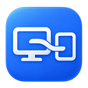
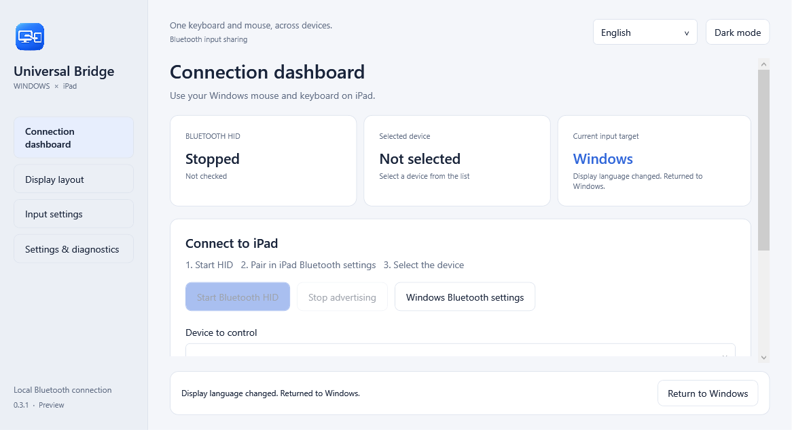
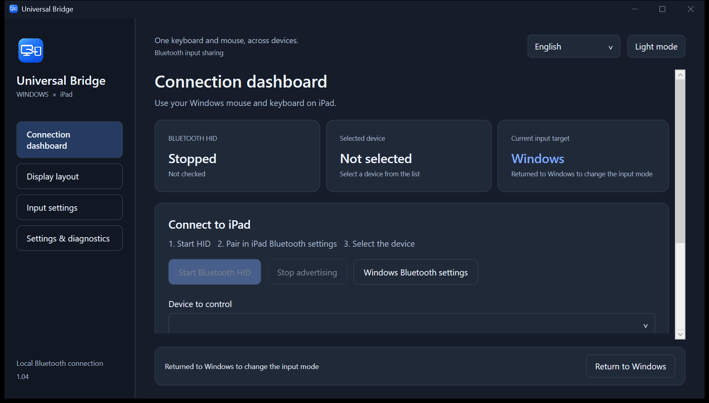

# Universal Bridge



**[English](README.en.md) · [日本語](README.md) · [简体中文](README.zh-CN.md)**

**Windows on your desk. iPad beside it. One keyboard and mouse.**

Share a Windows PC's keyboard, mouse, and supported trackpad gestures with an iPad over Bluetooth. A native Windows 11 app built with C# / .NET 10 / WPF, released under the [MIT license](LICENSE).

No iPad companion app or extra hardware is needed. Input sharing works offline; optional update checks/downloads contact GitHub. The PC's Bluetooth adapter and driver must support the **BLE Peripheral** role.

**v2.0.0 — regular release.** Basic keyboard and mouse input has been confirmed by a user on iPad. Gesture mappings, app-specific shortcuts, and different hardware still need real-device testing. This project is independent of Apple and Microsoft.

**[Download](https://github.com/noppy3325-droid/universal-bridge/releases/tag/v2.0.0) · [Check requirements](#before-you-download) · [Quick start](#quick-start)**



## Who is it for?

- **Windows + iPad desks:** keep working on your PC, then switch the same keyboard and mouse to an iPad for a search or a note.
- **Laptop users with limited desk space:** try sharing the controls you already have, without a second keyboard or a VM on supported PCs.
- **Early adopters and contributors:** explore a native C# / WPF BLE HID implementation with Japanese, English, and Simplified Chinese UI.

Apple's [Universal Control requires a Mac](https://support.apple.com/en-us/102459). Universal Bridge focuses on Windows-to-iPad input sharing. It also offers text clipboard sharing through Safari. Screen mirroring and file transfer are not provided. Contact relay was removed in v1.01.

## Before you download

You need **Windows 11 x64**, an iPad, and a PC Bluetooth adapter **and driver supporting BLE Peripheral**. Bluetooth support alone does not establish compatibility; the app checks the adapter and reports unsupported configurations. Gesture capture additionally requires supported experimental APIs on Windows 11 24H2 or later. Keyboard/mouse sharing can be used with gesture capture off.

This is an **unsigned release** with limited real-device coverage. If your hardware is unsupported, no purchase is needed to report the result. Optional [compatibility reports](https://github.com/noppy3325-droid/universal-bridge/issues/new?template=compatibility.yml) help identify which setups work.

## Download

Open **[Releases — v2.0.0](https://github.com/noppy3325-droid/universal-bridge/releases/tag/v2.0.0)**:

- **[UniversalBridge-2.0.0-win-x64.zip](https://github.com/noppy3325-droid/universal-bridge/releases/download/v2.0.0/UniversalBridge-2.0.0-win-x64.zip)** — extract and run `UniversalBridge.exe`. Includes .NET; no separate runtime installation.
- `UniversalBridge-2.0.0-source.zip` — source without SDKs, caches, settings, or logs.
- [UniversalBridge.exe](https://github.com/noppy3325-droid/universal-bridge/releases/download/v2.0.0/UniversalBridge.exe) — Standalone executable for updates; the ZIP also includes documentation.
- `SHA256SUMS.txt` — SHA-256 checksums for the executable and archives.

Windows x64 only. The executable is unsigned; no installer, MSIX, or code signing is provided.

## Features

| Feature | What it does |
|---|---|
| Bluetooth keyboard/mouse | Sends standard HID reports to one selected, paired iPad, with encrypted GATT access. |
| Screen-edge switching | Configure the display, edge, switching area, and hold time; respects adjacent Windows monitors. |
| Editable shortcuts | **Ctrl+Alt+I** to iPad; **Ctrl+Alt+Q** to Windows by default. Edit both in Input settings. **Esc three times** always provides emergency return. |
| Precise relative mouse input | Raw Input avoids Windows acceleration; sensitivity **0.02–4.00** in 0.01 steps, preserving fractional movements. |
| Trackpad mappings | Two-finger vertical/horizontal scrolling with dedicated **0.25–12.00 ×** sensitivity (default **3.00 ×**), pinch-to-zoom shortcuts, and configurable three-to-five-finger swipes. |
| Three UI languages | Japanese, English, Simplified Chinese, or system language; applies immediately and persists. |
| Desktop integration | Custom application/tray icon, light/dark theme, optional sign-in startup, diagnostics, and bounded reconnect attempts. |

**Gestures** generate standard scroll reports and supported keyboard shortcuts. Magic Trackpad's proprietary protocol is not used. Zoom, Home, and other actions depend on iPadOS and the app.

## v2.0.0: Safari clipboard sharing and a corner status card

Share plain text in both directions with Safari on an iPad on the same Wi-Fi. Start Clipboard sharing in the Windows app, set up this PC’s certificate once, then enter the six-digit connection code. Fetch Windows text and copy it to iPad, or paste iPad text into the page and send it to Windows. **Plain text only, up to 64 KiB in UTF-8.** Automatic sync, images and files are not supported. No internet service or iPad companion app is needed.

Text travels over HTTPS. Content, codes and session cookies are not logged. Sharing starts off and sessions are revoked on stop, exit, Windows session changes and sleep. The HTTP setup listener serves only the public certificate and setup instructions, with no clipboard access. [Setup and usage](docs/CLIPBOARD.en.md). Final iPad device acceptance has not been performed.

A small status card appears at the bottom right during iPad control. It follows light/dark mode, shows the return shortcut and triple-Esc, avoids the taskbar, does not activate, and passes clicks through to the content behind it.

Upgrade from v1.05 using Settings & diagnostics → App updates. Versions through v1.04 need a manual download once.

## v1.05: consistent Universal Bridge executable name

The standalone download, executable inside the ZIP, build output and update metadata now use `UniversalBridge.exe`. Packaging rejects the previous executable name.

The v1.04 and earlier updaters hardcode the old filename, so download this release manually once. Fully exit the old app before launching the new one; settings carry over. If you use launch at Windows startup, turn it off and on in the new app to register its path.

## v1.03: Japanese default README, title bar themes and in-app updates

The default GitHub README is now Japanese. English remains in this file. Switching dark/light mode also changes the native Windows title bar, text and border.

Use **Settings & diagnostics → App updates** to enable/disable automatic checks, check manually, or **Update and restart**. Only stable releases are offered. Automatic checks run at startup and while open, at most once per 24 hours; downloads start only when you choose to apply. Checks/downloads contact GitHub, while input sharing works offline.

The app returns control to Windows and stops input before replacing its executable. Size, SHA-256 and executable version are verified; settings stay in place. A startup failure restores and restarts the previous executable. Keep the app in a writable folder. The updater replaces the exe; use the ZIP to refresh bundled documents. Control remains on Windows after restarting.

**From v1.04 or earlier, download v2.0.0 manually once.** The executable is now `UniversalBridge.exe`; older updaters require the previous filename and cannot perform this migration. Fully exit the old app before starting the new one; saved settings carry over. If you use launch at Windows startup, turn it off and on in the new app to register its new path. Subsequent compatible releases can update inside the app.



## v1.02: prevent accidental returns from small movements

v1.01 started the estimate near the connected edge, allowing small reversals to return control. The estimate now starts in the middle, and automatic return is blocked for one second after switching. Crossing the estimated boundary is only a candidate: keep moving toward Windows for at least 300 ms and a minimum travel distance to confirm return. A longer edge wait configured in Display layout also applies.

A single flick, tiny jitter, or a small move after stopping cannot return control. Stopping, reversing, moving parallel to the edge, scrolling or key/button input restarts confirmation. Overshoot is not carried forward. Windows-to-iPad switching, pointer sensitivity and return shortcuts are retained.

Actual iPad coordinates remain unavailable. Adjust the estimated range, or disable only automatic return in Display layout and use Ctrl+Alt+Q / Esc three times. Actual iPad feel still needs hardware confirmation after updating.

## v1.01 history (return confirmation changed in v1.02)

Removes the optional iPad contact relay from settings, HID reports and diagnostics. Two-finger scrolling and pinch/swipe-to-key conversion remain available.

Enable **Display layout → Switch automatically between Windows and iPad at the screen edge**. Moving toward the Windows-facing edge now returns control to Windows. **Return from iPad to Windows automatically** defaults to on, including profiles that disabled the old estimated-return option. Held keys/buttons prevent return; release them and make a fresh movement toward the edge. The Windows cursor lands 32 pixels inside the connected edge.

**The return boundary is estimated from relative motion; the actual iPad pointer position is unavailable.** iPadOS acceleration and touch interaction can cause drift. Adjust **Estimated iPad range (width × height)** in Display layout if needed (default 1366 × 1024, each 320–8192). Ctrl+Alt+Q or Esc three times still returns control. Actual iPad return position and feel require hardware confirmation after updating.

Fully exit the old app before updating. If you used contact relay and iPad retains the old HID format, manually forget the PC and pair again only if reconnection fails.

## v1.00: edge handoff, precision and more actions

This is a regular release. Edge detection now samples the physical cursor after Windows finishes its mouse update. Arrival uses an approximately four-pixel band; connection checks tolerate up to 12 pixels of inward jitter. Leaving the portal, keys/buttons, lost readiness or changed settings cancels the request, which expires after five seconds. Diagnostics report the cancellation category without coordinates or input content. Enable edge switching in Display layout.

Fast-pointer stabilization now carries fractional errors on both axes after the transfer, fixing shallow diagonal movement losing its smaller axis. A 1000-sample synthetic trace produced 249 minor-axis counts versus zero previously, against a 248.69-count mathematical reference, with cumulative error below 0.5 count. Compressed distance is never replayed after stopping. With stabilization off, Raw Input and sensitivity provide linear transfer. **Actual iPad wireless latency, host acceleration and parity with Apple's controls have not been measured.**

Seven actions join Home, Search and Next app. Enable each action, edit its binding, then Apply shortcuts. They remain ordinary keys on Windows.

| Added action | Default | Sent to iPad |
|---|---|---|
| Previous app | Ctrl+Alt+P | ⇧⌘Tab |
| Screenshot | Ctrl+Alt+C | ⇧⌘3 |
| Undo / Redo | Ctrl+Alt+Z / Y | ⌘Z / ⇧⌘Z |
| Zoom in / out | Ctrl+Alt+U / D | ⇧⌘= / ⌘− |
| Close window | Ctrl+Alt+W, disabled by default | ⌘W |

Zoom and editing depend on the app. Home still uses the compatibility ⌘H path rather than emulating Globe. Remaining device acceptance checks are in the [test checklist](docs/MANUAL_TESTS.md).

## 0.5.0: iPad action shortcuts and edge switching

Dedicated actions work only while controlling iPad. Edit all five bindings together in **Input settings → Shortcuts**, then choose **Apply shortcuts**. Duplicate bindings are rejected. The three action chords remain ordinary keys while controlling Windows.

| iPad action | Default | Sent keys |
|---|---|---|
| Home | **Ctrl+Alt+H** | ⌘H, on compatible iPadOS/settings |
| Search | **Ctrl+Alt+S** | ⌘Space |
| Next app | **Ctrl+Alt+N** | ⌘Tab |

Holding a trigger runs the action once, without typing H/S/N. Release other character keys and mouse buttons first. The action shortcuts can be disabled independently. Home uses the compatibility ⌘H path; it does not emulate Apple's Globe key. **The new actions have not been verified on iPad hardware.** Apple's current iPadOS guidance uses Globe+H, so Home support depends on iPadOS and settings.

**To switch at the edge:** start HID, select the connected iPad, then enable edge switching in **Display layout**. Select a Windows monitor and direction, or drag the iPad diagram above, below, left or right. Blue lines show the available portal. Move the cursor to that edge and wait for the configured delay: 300ms by default, adjustable from 150 to 1500ms. The wait completes even after mouse movement stops.

Shared Windows-monitor boundaries are excluded; partial adjacency leaves the uncovered segment usable. Leaving the edge, pressing a key/button or changing settings cancels a pending activation. Remaining at the same edge cannot repeatedly reactivate it. The UI explains off, HID waiting, missing target and readiness states. Edge switching is off by default. **The iPad's actual pointer coordinates cannot be read, so control resumes at its previous position there.** v1.01 adds estimated edge return as described above. Ctrl+Alt+Q or Esc three times remains available.

[Settings screenshots — shortcuts](docs/images/shortcuts-en.png) · [Settings screenshots — layout](docs/images/layout-en.png)

## Quick start

1. Exit older versions via **Settings & diagnostics → Exit application**. Extract the ZIP and launch `UniversalBridge.exe` as a normal user.
2. Select **日本語 / English / 简体中文 / System language** at the top right.
3. Choose **Start Bluetooth HID**. Unsupported hardware or policy restrictions appear in the app.
4. In iPad **Settings → Bluetooth**, select the **Windows PC's computer name**. Confirm pairing on both devices yourself.
5. Select the iPad in the app. Pairing and both keyboard/mouse subscriptions must be ready.
6. Press **Ctrl+Alt+I and release all keys**, or use the switch button. Test typing, clicks, and scrolling in Notes. Return with **Ctrl+Alt+Q** or **Esc three times**.
7. Adjust sensitivity, gesture assignments, and shortcuts in **Input settings**. Shortcuts require **Apply shortcuts**; other changes save automatically. Enable edge switching after testing input.

During gesture capture, a small foreground window receives touchpad input. Focusing another Windows window returns control to Windows. Capture needs compatible **experimental Precision Touchpad APIs on Windows 11 24H2 or later**, checked at runtime. If unavailable, turn capture off to share keyboard/mouse only; Windows system gestures are then not blocked.

Upgrading from 0.1.x changes the mouse report from 6 to 7 bytes for horizontal scrolling. If mouse input stops, reconnect; if necessary, manually forget the PC on iPad and pair again.

Since v0.3.1, **Input settings → Two-finger scroll sensitivity** adjusts captured touchpad scrolling independently of the mouse wheel. The recommended 3.00 is three times the previous default. Numeric input, 0.25 steps, and a reset button are available. Cumulative motion preserves movement at gesture onset and completion. Standard HID still uses whole scroll ticks rather than pixel scrolling; no extra momentum is simulated.

## Privacy and recovery

v0.3.4 introduced improved fine diagonal motion with centered rounding and fractional carry, keeps direction when splitting large movement, and uses a private high-resolution mouse report timer. The local cadence supports 8 ms when the BLE link allows it; the actual negotiated connection interval still applies. Adjacent unsent XY movement can coalesce under load, with keys, clicks, wheel/pan, reversal, and range limits kept as barriers. Existing sensitivity settings are retained. iPad cursor feel and wireless latency still need real-device verification.

v0.3.3 fixes a reproducible case where the iPad remained connected but switching was refused as “input held.” A JIS half/full key's IME mode value could remain in the local held-key check after returning to Windows. The physical OEM key is now checked instead, and released quarantine entries are cleaned up. Rejection diagnostics record only key counts and mouse/idle flags, without key identities or typed content. Other intermittent failures still need their own diagnostic evidence.

After iPad sleep/wake, unlock the iPad and wait for both report subscriptions, then press your iPad activation shortcut again. Since v0.3.2 the app tracks replacement GATT sessions and recovers a failed sender after successfully releasing both keyboard and mouse. Input is never recaptured automatically; an unfinished timed-out send must complete before recovery can proceed. If the iPad remains disconnected, reconnect the PC from iPad Settings → Bluetooth.

On a Windows Japanese keyboard, **半角/全角** (also Alt+半角/全角) now sends one **Control+Space** tap to cycle iPad input languages instead of typing punctuation. Holding the key does not repeatedly cycle languages. US backtick keeps its usual mapping. Add both Japanese and English in iPad Settings → General → Keyboard → Keyboards; language switching follows [iPad's external-keyboard shortcut](https://support.apple.com/en-euro/guide/ipad/ipaddd28d7ed/ipados). Keyboard layout/IME behavior still depends on iPadOS settings.

Input text and HID payloads are not logged. Settings/connection diagnostics stay in `%LOCALAPPDATA%\UniversalBridge`; logs rotate at 1 MiB. There is no telemetry. Optional update checks/downloads contact GitHub.

Connection, subscriptions, input hooks, and released keys are checked before switching. Disconnects, capture focus loss, queue failure, sleep, and session changes return control to Windows. Reconnecting never captures input automatically. Sudden termination cannot send release reports to iPad; recovery there depends on Bluetooth disconnect handling.

To uninstall, disable optional startup, exit, and remove the extracted folder. Remove local settings and iPad pairing separately if desired.

## Build and test

Windows 11 x64, PowerShell 7, **.NET SDK 10.0.402**. Restore needs internet; runtime does not. Minimum OS build: 22000; gesture capture additionally needs supported APIs on build 26100 or later.

```powershell
# Optional: Microsoft's verified SDK, local to this folder.
pwsh -File scripts/Setup-Sdk.ps1
# Build, tests, and self-contained Windows package.
pwsh -File scripts/Build.ps1 -Test -Publish
# Binary/source archives and checksums.
pwsh -File scripts/Package.ps1
```

SDK/packages stay under `.tools/`. Windows SDK projection: `10.0.26100.87`; experimental APIs are isolated and checked. No drivers, registry workarounds, VMs, or OS security changes are installed.

**276 automated tests** cover HID, diagonal precision and splitting, motion backpressure/order, sleep/reconnect recovery, JIS input, shortcuts, translations, and language persistence. GUI smoke tests exercise three languages without capturing input. These do not replace iPad hardware tests.

See [contributing/translations](CONTRIBUTING.md), [architecture](ARCHITECTURE.md), [limitations](KNOWN_LIMITATIONS.md), [verification](TEST_REPORT.md), and [hardware checks](docs/MANUAL_TESTS.md). Detailed engineering notes are currently Japanese. GitHub Actions tests pushes/PRs; version tags build downloadable releases.

## License and credits

[MIT](LICENSE). HID descriptor/keymap portions adapted from [windows-ble-hid](https://github.com/abhishek-raj/windows-ble-hid); OpenSpan reviewed as research. Attribution and runtime notices: [THIRD_PARTY_NOTICES.md](THIRD_PARTY_NOTICES.md), [licenses](licenses).
