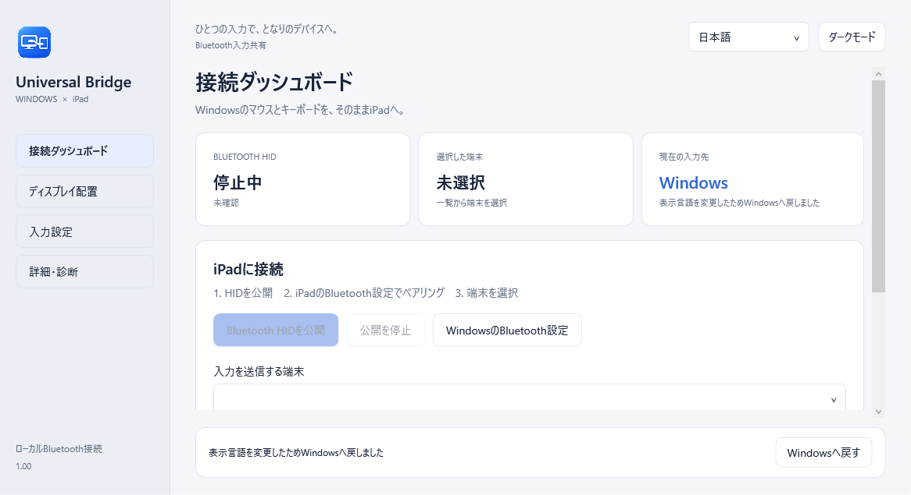

# Universal Bridge


**[English](README.md) · [日本語](README.ja.md) · [简体中文](README.zh-CN.md)**

**Windowsの隣のiPadも、いつものキーボードとマウスで。**

Windows PCのキーボード・マウスと対応するトラックパッド操作を、Bluetooth経由でiPadと共有するWindows 11アプリです。C# / .NET 10 / WPFで実装し、[MITライセンス](LICENSE)のOSSとして公開しています。

iPad用アプリ、追加機器、使用中のインターネットは不要です。Bluetoothアダプターとドライバーには **BLE Peripheral** 対応が必要です。

**v1.00（通常リリース）。** 基本のキーボード入力・マウス操作はiPadでの成功報告があります。ジェスチャー変換、アプリ固有キー、異なる機器は実機確認が残ります。Apple・Microsoftの公式製品ではありません。

**[ダウンロード](https://github.com/noppy3325-droid/universal-bridge/releases/tag/v1.00) · [必要な環境](#ダウンロード前に) · [使い始める](#使い始める)**



## こんな使い方に

- **WindowsとiPadを机に並べている方：** PCで作業しながら、同じキーボードとマウスをiPadへ切り替えて検索やメモに。
- **ノートPCを使い、机を広く使いたい方：** 対応PCなら、2組目のキーボードやVMを用意せずに、手元の入力機器を共有できます。
- **利用・開発に参加する方：** 日本語・英語・簡体字GUIを備えた、C# / WPFによるBLE HIDの実装を公開しています。

Appleの[ユニバーサルコントロールにはMacが必要](https://support.apple.com/en-us/102459)です。Universal BridgeはWindowsからiPadへの入力共有を扱い、画面ミラーリング・クリップボード共有・ファイル転送は提供しません。接点転送は下記の実験的モードです。

## ダウンロード前に

必要なのは **Windows 11 x64・iPad・BLE Peripheral対応のBluetoothアダプターとドライバー** です。Bluetooth搭載だけでは対応を判断できません。アプリで対応状況を確認し、非対応なら理由を表示します。ジェスチャー取得には、Windows 11 24H2以降の対応する実験的APIも必要です。取得をオフにしてキーボードとマウスのみ共有することもできます。

実機の確認範囲が限られた **署名なしの通常リリース** です。非対応の場合も、追加購入は不要です。任意の[動作環境レポート](https://github.com/noppy3325-droid/universal-bridge/issues/new?template=compatibility.yml)で、動く構成・動かない構成を共有できます。

## ダウンロード

**[Releases — v1.00](https://github.com/noppy3325-droid/universal-bridge/releases/tag/v1.00)** から取得します。

- **[UniversalBridge-1.0.0-win-x64.zip](https://github.com/noppy3325-droid/universal-bridge/releases/download/v1.00/UniversalBridge-1.0.0-win-x64.zip)**：展開して `UniversalControl.exe` を起動。.NET同梱で別途ランタイムは不要です。
- `UniversalBridge-1.0.0-source.zip`：SDK・キャッシュ・設定・診断ログを含まないソースです。
- `SHA256SUMS.txt`：exeとZIPのSHA-256チェックサムです。

Windows x64専用、署名なしのexeです。インストーラー・MSIX・コード署名は提供していません。

## 主な機能

| 機能 | 内容 |
|---|---|
| Bluetoothキーボード・マウス | ペア済みの選択端末1台へ標準HIDを送信。GATTは暗号化必須です。 |
| 画面端切り替え | ディスプレイ・方向・範囲・押し続け時間を設定。隣接Windowsモニターとの境界を考慮します。 |
| ショートカット編集 | 初期値はiPadへ **Ctrl+Alt+I**、Windowsへ **Ctrl+Alt+Q**。入力設定から変更可能。**Escを3回**の緊急復帰は常に有効です。 |
| 細かいマウス操作 | Raw InputでWindowsの加速を回避。感度 **0.02～4.00**、0.01刻み、小数移動量の保持に対応します。 |
| トラックパッド変換 | 2本指の縦横スクロール感度を専用の **0.25～12.00倍**（初期値 **3.00倍**）で調整。ピンチのキー変換、3～5本指スワイプも対応します。 |
| 3言語のGUI | 日本語・英語・中国語（簡体字）・システム言語。即時反映し次回起動時も保持します。 |
| 常駐と診断 | 専用アプリ／トレイアイコン、ライト／ダーク、任意のサインイン時起動、接続診断、回数制限付き再接続。 |

**既定の互換モード**は標準HIDのスクロール・対応キーへ変換します。接点転送は下記の試験版を明示的に有効化します。Magic Trackpad固有プロトコルは使いません。拡大縮小・ホーム等はiPadOSやアプリに依存します。

## v1.00：画面端・精度・追加操作

通常リリースです。画面端の処理を、マウス通知の後に確定した物理カーソル位置を確認する方式へ変更しました。端の到着は約4pxの帯、接続確認中は端から12pxまでの小さな揺れを許容します。端を離れた場合・キーやボタン操作・接続準備の消失・設定変更は取り消し、5秒で期限切れになります。拒否時の診断は原因別とし、座標や入力内容は記録しません。自動切り替えは「ディスプレイ配置」で有効にしてください。

急な移動の抑制を使う場合も、変換後の小数をXYそれぞれ持ち越します。これにより、浅い斜め方向の短い軸が丸めで消える問題を修正しました。人工入力1000回では旧処理の短い軸0カウントに対して249カウント、計算上の基準248.69カウント、累積誤差0.5カウント未満でした。停止後に抑えた距離を再生しません。抑制オフはRaw Inputに感度だけを掛ける線形方式です。**iPadの実際の無線遅延・カーソル加速・純正と同等の操作感は測定していません。**

ホーム・検索・次のアプリに、次の7操作を追加しました。各操作をオン／オフにし、キーを変更して「ショートカットを適用」で保存できます。Windows操作中は通常のキーです。

| 追加操作 | 初期値 | iPadへの送信 |
|---|---|---|
| 前のアプリ | Ctrl+Alt+P | ⇧⌘Tab |
| スクリーンショット | Ctrl+Alt+C | ⇧⌘3 |
| 取り消す／やり直す | Ctrl+Alt+Z／Y | ⌘Z／⇧⌘Z |
| 拡大／縮小 | Ctrl+Alt+U／D | ⇧⌘=／⌘− |
| ウィンドウを閉じる | Ctrl+Alt+W（初期値オフ） | ⌘W |

拡大・縮小や編集操作はアプリに依存します。ホームは引き続き⌘H互換で、Globeキーの生成ではありません。実機の最終受け入れ項目は[チェック手順](docs/MANUAL_TESTS.md)へ記載しています。

## 0.5.0：iPad操作キーと画面端切り替え

iPadを操作している間だけ、次の専用ショートカットを使えます。「入力設定 → ショートカット」で5種類の操作をまとめて編集し、「ショートカットを適用」で保存します。重複する組み合わせは拒否します。Windowsを操作している間、3つのiPad操作キーは通常のキーとして使えます。

| iPad操作 | 初期値 | 送信するキー |
|---|---|---|
| ホームへ戻る | **Ctrl+Alt+H** | ⌘H（対応するiPadOS／設定） |
| 検索 | **Ctrl+Alt+S** | ⌘Space |
| 次のアプリ | **Ctrl+Alt+N** | ⌘Tab |

長押しでも1回だけ実行し、文字としてのH／S／Nは送りません。ほかの文字キー・マウスボタンを離して使ってください。必要ならiPad操作キーだけをオフにできます。ホームは⌘Hの互換経路で、Apple固有のGlobeキーを生成しません。**新しい操作キーのiPad実機確認は未実施です。** 現行iPadOSの公式案内はGlobe+Hを使うため、ホームの対応はiPadOS／設定に依存します。

**画面端で切り替えるには：** HID公開・接続先iPadの選択後、「ディスプレイ配置」で自動切り替えをオンにします。使用するWindowsモニターと方向を選ぶか、iPadの図を上下左右へドラッグします。青い線が有効な範囲です。その端にカーソルを移し、設定した時間（初期値300ms、150～1500ms）待つと操作先がiPadへ移ります。端で手を止めても待機を完了します。

Windowsモニター同士の境界は除外し、一部が隣接する場合は空いている範囲だけを使います。待機中に端から離れる・キーやボタンを押す・設定が変わると取り消します。同じ場所に留まっているだけでは再実行しません。画面にはオフ／HID待ち／端末未選択／準備完了などの理由を表示します。自動切り替えは初期値オフです。**iPadの実カーソル座標は取得しないため、切り替え後はiPad上の前回位置から操作します。** Windows復帰はCtrl+Alt+QまたはEscを3回です。

[設定画面 — shortcuts](docs/images/shortcuts-ja.png) · [設定画面 — layout](docs/images/layout-ja.png)

## 0.4.0：急な移動とiPad向け接点転送

- **急な移動の抑制（初期値オン）：** 速い動きにだけ方向を保つ緩やかな制限をかけ、抑えた距離を後から流しません。その分、高速時の移動距離は短くなります。「入力設定」でオフにすると従来の線形入力になります。送信待ちの合流も各軸127カウントまでにし、大きな一括移動を減らします。
- **2本指スクロール：** 互換モードの小数持ち越しを最近傍丸めへ変更し、動き始めの反応を早めました。専用感度は引き続き調整できます。整数ホイール単位であり、ピクセル単位のスクロールではありません。
- **iPad純正ジェスチャー向けの接点転送（試験版・初期値オフ）：** 対応Precision Touchpadから取得した2～5本指の実接点を標準HID Touch Padとして送り、スクロール・ピンチ・スワイプの認識をiPadOSへ任せる構成です。**iPad実機での認識・動作は未確認です。Magic Trackpadと同等の全機能は保証しません。** Windowsはタップ／長押しの接点列を通常公開しないため、すべての純正ジェスチャーは再現できません。1本指のカーソルはマウス経路を使います。

試験版を使うには「入力設定 → iPad純正ジェスチャー向けの接点転送」をオンにし、**アプリを完全終了して再起動**します。HID公開後に接点購読の✓を確認してください。Report Mapが変わるため、認識しない場合はiPadでPCを登録解除・再ペアリングする必要があります。アプリから登録を自動削除しません。オフへ戻す場合も再起動が必要です。接点モードはiPadOS 14.5以降の標準トラックパッド仕様を対象にしますが、対応Windows API、3種類の入力購読、Surface Switch、28バイト以上の通知が必要です。未準備なら切り替えを拒否して理由を表示します。

接点モードではアプリのスクロール感度・ピンチ／スワイプのキー割り当てを使わず、iPad側で処理します。診断はAPI対応・接点フレーム件数・最大接点数だけを記録し、座標や入力内容は記録しません。[実機確認手順](docs/MANUAL_TESTS.md)も参照してください。

## 使い始める

1. 旧版を「詳細・診断 → アプリを終了」で終了します。ZIPを展開し、通常権限で `UniversalControl.exe` を起動します。
2. 右上で **日本語 / English / 简体中文 / システムの言語** を選べます。
3. 「Bluetooth HIDを公開」を押します。非対応機器やポリシーの制限は画面に表示されます。
4. iPadの「設定 → Bluetooth」で **Windows PCのコンピューター名** を選び、両端末で人がペアリング確認を行います。
5. アプリでiPadを選び、ペア済み・キーボードとマウスの両購読が揃ったことを確認します。
6. **Ctrl+Alt+Iを押して全キーを離す**、または切り替えボタンでiPadへ移ります。メモ等で入力・クリック・スクロールを試し、**Ctrl+Alt+Q** または **Escを3回** で戻ります。
7. 「入力設定」で感度・ジェスチャー・キーを変更します。キーは「ショートカットを適用」で保存し、その他は自動保存。確認後に画面端切り替えを有効にしてください。

ジェスチャー取得中は小さな受け取り画面が前面に出ます。別のWindows画面へフォーカスが移るとWindowsへ戻ります。**Windows 11 24H2以降の対応する実験的Precision Touchpad API**を実行時に確認します。未対応なら取得をオフにするとキー・マウスのみ使えます。この場合、Windowsのシステムジェスチャーは抑制しません。

0.1.xからの更新は、横スクロール追加でマウスレポートが6→7バイトになります。動かなければ再接続し、必要ならiPad側で人がPC登録を解除・再ペアリングしてください。

v0.3.1以降は「入力設定 → 2本指スクロール感度」でマウスホイールとは独立して調整できます。推奨値3.00は旧版の既定値の3倍です。数値入力・0.25刻みの増減・推奨値へ戻す操作に対応し、動き始めと終了直前の移動量も累積値から拾います。標準HIDの整数スクロール単位であり、ピクセル単位の連続スクロールや追加の慣性は生成しません。

## プライバシーと復帰

v0.3.4以降は、斜めの微小移動を小数持ち越し付きの最近傍丸めへ変更し、大きい移動を分割するときも方向を保ちます。マウス送信には専用の高精度タイマーを使い、BLE接続間隔が許す場合はローカルの最短周期を8msにします。送信待ちでは隣り合うXY移動だけを合流し、キー・クリック・縦横スクロール・方向反転・レポート上限を境界として保ちます。保存済み感度は変更しません。iPad実機の操作感・無線遅延は更新後の確認が必要です。

v0.3.3では、iPadが接続済みでも「キー押下中」で切り替えを拒否する再現ケースを修正しました。半角／全角キーのIMEモード値がWindows復帰後の判定に残るため、物理OEMキーの状態を確認するよう変更し、解放済みの待機状態も整理します。拒否時の診断にはキー件数とマウス／入力待機の真偽だけを追加し、キー名や入力内容は記録しません。他の断続的な失敗がすべて解消したと確認したものではありません。

iPadのスリープ復帰後はロックを解除し、両購読が揃ってからiPadへの切り替えショートカットを押し直してください。v0.3.2以降は新しいGATTセッションを追跡し、キーボード・マウス両方の解放送信が成功した場合に送信処理を復帰します。自動で操作先をiPadへ戻さず、タイムアウトした送信が未完了なら完了まで復帰を拒否します。切断のままならiPad「設定 → Bluetooth」でPCへ接続してください。

Windowsが日本語キーボードとして認識している場合、**半角／全角**（Alt併用も対応）は記号を送らず、**Control+Spaceを1回**送ってiPadの入力言語を切り替えます。長押しで連続切り替えせず、US配列のバッククォートは維持します。iPad「設定 → 一般 → キーボード → キーボード」に日本語と英語を追加してください。[iPadの外付けキーボード用ショートカット](https://support.apple.com/en-euro/guide/ipad/ipaddd28d7ed/ipados)を使うため、配列やIMEの最終的な動作はiPadOSの設定に従います。

入力文字列やHIDペイロードは記録しません。設定・接続診断は `%LOCALAPPDATA%\UniversalBridge` に置き、ログは1MiBでローテーションします。テレメトリーや実行時クラウドサービスはありません。

接続・両購読・フック・キー解放の確認後だけ切り替えます。切断、取得中のフォーカス喪失、キュー異常、スリープ、セッション変更でWindowsへ戻り、再接続時に自動捕捉しません。強制終了時はiPadへ解放レポートを送れず、iPad側の復帰はBluetooth切断処理に依存します。

削除時は自動起動をオフにしてアプリを終了し、展開フォルダを削除します。設定フォルダ・iPadのペアリングは必要に応じて個別に削除してください。

## ビルドとテスト

Windows 11 x64、PowerShell 7、**.NET SDK 10.0.402**。依存取得時のみインターネットが必要です。最低OSはbuild22000、ジェスチャーにはbuild26100以降の対応APIが必要です。

```powershell
# 任意：Microsoft公式SDKを作業フォルダ内だけに準備
pwsh -File scripts/Setup-Sdk.ps1
pwsh -File scripts/Build.ps1 -Test -Publish
pwsh -File scripts/Package.ps1
```

SDKとパッケージは `.tools/` に保存。Windows SDK projectionは `10.0.26100.87` 固定で、実験的APIは分離・対応確認します。ドライバー、制限回避レジストリ、VM、OSのセキュリティ変更は導入しません。

**自動テスト216件**でHID・斜め移動と分割・送信待ちの合流と順序・スリープ／再接続・JISキー・ショートカット・翻訳・言語保存を検証します。GUIテストは入力を捕捉せず3言語を確認し、iPad実機確認とは区別します。

[開発・翻訳参加](CONTRIBUTING.md)、[構成](ARCHITECTURE.md)、[制約](KNOWN_LIMITATIONS.md)、[検証結果](TEST_REPORT.md)、[実機チェック](docs/MANUAL_TESTS.md)を参照してください。GitHub Actionsでpush・PRをビルド／テストし、バージョンタグから通常Releaseを生成します。

## ライセンスと謝辞

[MIT](LICENSE)。HID descriptor/keymapの一部を [windows-ble-hid](https://github.com/abhishek-raj/windows-ble-hid) から改変し、OpenSpanを調査資料として参照しています。出典・同梱通知は [THIRD_PARTY_NOTICES.md](THIRD_PARTY_NOTICES.md) と [licenses](licenses) に収録しています。
