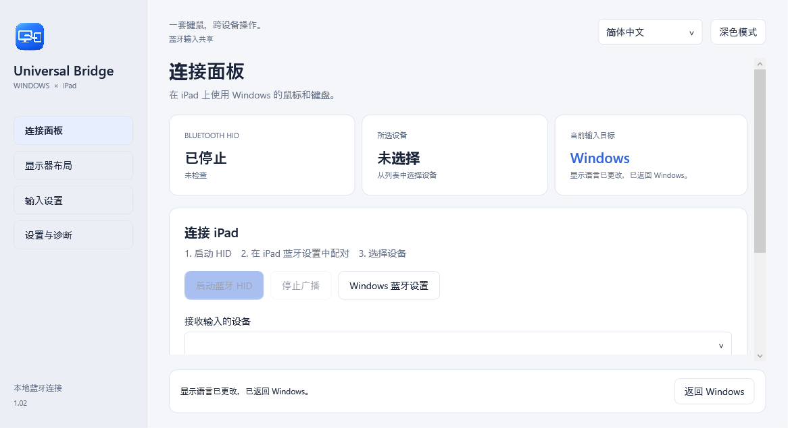

# Universal Bridge


**[English](README.md) · [日本語](README.ja.md) · [简体中文](README.zh-CN.md)**

**Windows 旁边的 iPad，也用同一套键盘和鼠标。**

通过蓝牙，将 Windows 电脑的键盘、鼠标和受支持的触控板操作共享给 iPad。这是一款使用 C# / .NET 10 / WPF 开发的 Windows 11 原生应用，以 [MIT 许可证](LICENSE) 开源。

无需 iPad 配套应用、额外硬件或运行时互联网连接。电脑的蓝牙适配器和驱动程序必须支持 **BLE 外围设备角色（Peripheral）**。

**预览版 v0.3.3。** 已有用户确认 iPad 的基本键盘和鼠标输入可用。手势映射、应用特定快捷键和不同硬件仍需实机验证。本项目并非 Apple 或 Microsoft 官方产品。

**[下载预览版](https://github.com/noppy3325-droid/universal-bridge/releases/tag/v0.3.3) · [查看要求](#下载前请确认) · [快速开始](#快速开始)**



## 适合哪些使用场景？

- **同时使用 Windows 和 iPad：** 在电脑上工作，再将同一套键鼠切换到 iPad 搜索资料或记笔记。
- **希望节省桌面空间的笔记本用户：** 在受支持的电脑上，无需第二套键盘或虚拟机即可尝试共享现有输入设备。
- **愿意试用预览版或参与开发的用户：** 查看带有日语、英语和简体中文界面的 C# / WPF BLE HID 实现。

Apple 的[通用控制需要一台 Mac](https://support.apple.com/en-us/102459)。Universal Bridge 专注于 Windows 到 iPad 的输入共享，不提供屏幕镜像、剪贴板共享、文件传输或 iPad 原生多点触控转发。

## 下载前请确认

需要 **Windows 11 x64、iPad，以及支持 BLE 外围设备角色的蓝牙适配器和驱动程序**。仅有蓝牙功能不代表兼容；应用会检查支持情况并说明不兼容的原因。手势捕获还需要 Windows 11 24H2 或更新系统的受支持实验性 API。可关闭手势捕获，仅共享键盘和鼠标。

这是实机验证范围有限的 **未签名预览版**。若硬件不支持，无需额外购买设备。欢迎自愿提交[兼容性报告](https://github.com/noppy3325-droid/universal-bridge/issues/new?template=compatibility.yml)，帮助确认可用及不可用的配置。

## 下载

前往 **[Releases — v0.3.3](https://github.com/noppy3325-droid/universal-bridge/releases/tag/v0.3.3)**：

- **[UniversalBridge-0.3.3-win-x64.zip](https://github.com/noppy3325-droid/universal-bridge/releases/download/v0.3.3/UniversalBridge-0.3.3-win-x64.zip)**：解压并运行 `UniversalControl.exe`，已包含 .NET，无需另装运行时。
- `UniversalBridge-0.3.3-source.zip`：不含 SDK、缓存、用户设置或诊断日志的源码。
- `SHA256SUMS.txt`：可执行文件和压缩包的 SHA-256 校验值。

仅支持 Windows x64。可执行文件未签名，不提供安装程序、MSIX 或代码签名。

## 主要功能

| 功能 | 说明 |
|---|---|
| 蓝牙键盘和鼠标 | 向选定且已配对的一台 iPad 发送标准 HID 报告，GATT 访问要求加密。 |
| 屏幕边缘切换 | 设置显示器、方向、切换区域和持续推压时间，并考虑相邻 Windows 显示器。 |
| 自定义快捷键 | 默认 **Ctrl+Alt+I** 切换到 iPad，**Ctrl+Alt+Q** 返回 Windows。可在输入设置中修改，始终可**连按 Esc 3 次**紧急返回。 |
| 精细鼠标移动 | Raw Input 避免 Windows 加速；灵敏度 **0.02～4.00**，步长 0.01，保留小数移动量。 |
| 触控板映射 | 双指垂直／水平滚动专用灵敏度 **0.25～12.00 倍**（默认 **3.00 倍**），捏合转缩放快捷键和可配置的三至五指滑动。 |
| 三种界面语言 | 日语、英语、简体中文或跟随系统；切换立即生效并保存。 |
| 桌面集成 | 专用应用／托盘图标、浅色／深色主题、可选登录启动、诊断和有限次数重连。 |

**不会传输 iPad 原生多点触控数据或 Magic Trackpad 专用协议。** 手势会转换为标准滚动报告和受支持的按键操作。缩放、主屏幕等功能取决于 iPadOS 和应用支持。

## 快速开始

1. 通过“设置与诊断 → 退出应用”关闭旧版。解压 ZIP，以普通权限运行 `UniversalControl.exe`。
2. 在右上角选择 **日本語 / English / 简体中文 / 跟随系统语言**。
3. 点击“启动蓝牙 HID”。不支持的硬件或策略限制会显示在应用中。
4. 在 iPad“设置 → 蓝牙”中选择 **Windows 电脑的计算机名**，由使用者在两台设备上确认配对。
5. 在应用中选择 iPad，确认已配对且键盘和鼠标报告均已订阅。
6. **按 Ctrl+Alt+I 后松开所有按键**，或点击切换按钮。在备忘录等应用中测试输入、点击和滚动。按 **Ctrl+Alt+Q** 或**连按 Esc 3 次**返回。
7. 在“输入设置”中调整灵敏度、手势和快捷键。快捷键需点击“应用快捷键”，其他更改自动保存。确认正常后再启用屏幕边缘切换。

捕获手势时会显示小型前台接收窗口。焦点移到其他 Windows 窗口时将返回 Windows。此功能要求 **Windows 11 24H2 或更新系统的受支持实验性 Precision Touchpad API**，并在运行时检查。不支持时可关闭捕获，仅共享键鼠；关闭后不会拦截 Windows 系统手势。

从 0.1.x 升级时，为加入水平滚动，鼠标报告由 6 字节变为 7 字节。若无法工作，请重新连接；必要时由使用者在 iPad 上忽略此电脑并重新配对。

v0.3.3 可在“输入设置 → 双指滚动灵敏度”中独立调整触控板，与鼠标滚轮互不影响。推荐值 3.00 为旧版默认值的 3 倍，支持数值输入、0.25 步长和重置。累积位移保留手势开始和结束时的移动量。标准 HID 仍使用整数滚动刻度，不生成像素级滚动或额外惯性。

## 隐私与恢复

v0.3.3 修复了 iPad 保持连接却因“按键未释放”拒绝切换的可复现问题：半角/全角键的输入法模式值可能残留在返回 Windows 后的检测中，现在改为检查物理 OEM 键，并清理已释放的等待状态。拒绝诊断仅记录按键数量及鼠标／空闲状态，不记录键名或输入内容。尚未确认所有偶发问题都已解决。

iPad 唤醒后，请解锁并等待键盘、鼠标均恢复订阅，再按切换到 iPad 的快捷键。v0.3.3 会跟踪新的 GATT 会话，成功发送键盘和鼠标的释放报告后恢复发送程序。不会自动将控制切回 iPad；超时发送尚未完成时不能恢复。如果仍未连接，请从 iPad“设置 → 蓝牙”连接电脑。

Windows 识别为日语键盘时，**半角/全角**（支持 Alt 组合）会发送一次 **Control+Space** 来切换 iPad 输入语言，不再输入标点。长按不会反复切换；美式键盘的反引号保持原有映射。请在 iPad“设置 → 通用 → 键盘 → 键盘”中添加日语和英语。使用 [iPad 外接键盘的语言切换快捷键](https://support.apple.com/en-euro/guide/ipad/ipaddd28d7ed/ipados)，最终布局及输入法行为取决于 iPadOS 设置。

不记录输入文字或 HID 数据内容。设置和连接诊断保存在 `%LOCALAPPDATA%\UniversalBridge`，日志达到 1 MiB 时轮换。不使用遥测或运行时云服务。

确认连接、双报告订阅、输入钩子和所有按键释放后才切换。断开连接、捕获窗口失焦、队列异常、睡眠或会话变化时返回 Windows。重连不会自动捕获输入。突然终止进程时无法向 iPad 发送释放报告，iPad 恢复取决于蓝牙断开处理。

卸载时先禁用自动启动、退出应用，再删除解压目录。设置目录和 iPad 配对记录可按需另行删除。

## 构建与测试

需要 Windows 11 x64、PowerShell 7、**.NET SDK 10.0.402**。恢复依赖需要互联网，运行时不需要。最低系统 build22000；手势捕获还需 build26100 或更新系统的受支持 API。

```powershell
# 可选：仅在此目录准备 Microsoft 官方 SDK
pwsh -File scripts/Setup-Sdk.ps1
pwsh -File scripts/Build.ps1 -Test -Publish
pwsh -File scripts/Package.ps1
```

SDK／包位于 `.tools/`。Windows SDK projection 固定为 `10.0.26100.87`，实验性 API 已隔离并检查。不会安装驱动、修改注册表绕过限制、使用 VM 或更改系统安全设置。

**141 项自动测试**覆盖 HID、睡眠／重连恢复、返回 Windows 后残留的日语按键状态、语言切换、精度、快捷键、翻译和语言保存。GUI 测试在不捕获输入时验证三种语言，不能替代 iPad 实机测试。

参见[开发和翻译指南](CONTRIBUTING.md)、[架构](ARCHITECTURE.md)、[限制](KNOWN_LIMITATIONS.md)、[测试报告](TEST_REPORT.md)、[实机检查](docs/MANUAL_TESTS.md)。详细工程文档目前为日语。GitHub Actions 构建并测试 push／PR，并根据版本标签生成预览发行版。

## 许可证与致谢

[MIT](LICENSE)。部分 HID descriptor／keymap 改编自 [windows-ble-hid](https://github.com/abhishek-raj/windows-ble-hid)，并参考 OpenSpan。出处和运行时声明见 [THIRD_PARTY_NOTICES.md](THIRD_PARTY_NOTICES.md) 与 [licenses](licenses)。
