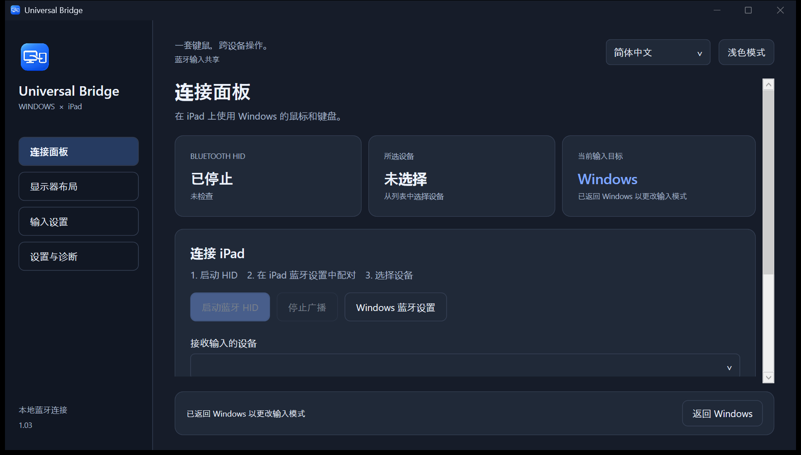

# Universal Bridge


**[English](README.en.md) · [日本語](README.md) · [简体中文](README.zh-CN.md)**

**Windows 旁边的 iPad，也用同一套键盘和鼠标。**

通过蓝牙，将 Windows 电脑的键盘、鼠标和受支持的触控板操作共享给 iPad。这是一款使用 C# / .NET 10 / WPF 开发的 Windows 11 原生应用，以 [MIT 许可证](LICENSE) 开源。

无需 iPad 配套应用或额外硬件。输入共享可离线使用，仅检查和下载更新时连接 GitHub。电脑的蓝牙适配器和驱动程序必须支持 **BLE 外围设备角色（Peripheral）**。

**v1.05（正式发布）。** 已有用户确认 iPad 的基本键盘和鼠标输入可用。手势映射、应用特定快捷键和不同硬件仍需实机验证。本项目并非 Apple 或 Microsoft 官方产品。

**[下载](https://github.com/noppy3325-droid/universal-bridge/releases/tag/v1.05) · [查看要求](#下载前请确认) · [快速开始](#快速开始)**


## 适合哪些使用场景？

- **同时使用 Windows 和 iPad：** 在电脑上工作，再将同一套键鼠切换到 iPad 搜索资料或记笔记。
- **希望节省桌面空间的笔记本用户：** 在受支持的电脑上，无需第二套键盘或虚拟机即可尝试共享现有输入设备。
- **愿意使用或参与开发的用户：** 查看带有日语、英语和简体中文界面的 C# / WPF BLE HID 实现。

Apple 的[通用控制需要一台 Mac](https://support.apple.com/en-us/102459)。Universal Bridge 专注于 Windows 到 iPad 的输入共享，不提供屏幕镜像、剪贴板共享或文件传输。触点转发已在v1.01中移除。

## 下载前请确认

需要 **Windows 11 x64、iPad，以及支持 BLE 外围设备角色的蓝牙适配器和驱动程序**。仅有蓝牙功能不代表兼容；应用会检查支持情况并说明不兼容的原因。手势捕获还需要 Windows 11 24H2 或更新系统的受支持实验性 API。可关闭手势捕获，仅共享键盘和鼠标。

这是实机验证范围有限的 **未签名正式版本**。若硬件不支持，无需额外购买设备。欢迎自愿提交[兼容性报告](https://github.com/noppy3325-droid/universal-bridge/issues/new?template=compatibility.yml)，帮助确认可用及不可用的配置。

## 下载

前往 **[Releases — v1.05](https://github.com/noppy3325-droid/universal-bridge/releases/tag/v1.05)**：

- **[UniversalBridge-1.0.5-win-x64.zip](https://github.com/noppy3325-droid/universal-bridge/releases/download/v1.05/UniversalBridge-1.0.5-win-x64.zip)**：解压并运行 `UniversalBridge.exe`，已包含 .NET，无需另装运行时。
- `UniversalBridge-1.0.5-source.zip`：不含 SDK、缓存、用户设置或诊断日志的源码。
- [UniversalBridge.exe](https://github.com/noppy3325-droid/universal-bridge/releases/download/v1.05/UniversalBridge.exe) — 用于自动更新的独立exe；ZIP另外包含文档。
- `SHA256SUMS.txt`：可执行文件和压缩包的 SHA-256 校验值。

仅支持 Windows x64。可执行文件未签名，不提供安装程序、MSIX 或代码签名。

## 主要功能

| 功能 | 说明 |
|---|---|
| 蓝牙键盘和鼠标 | 向选定且已配对的一台 iPad 发送标准 HID 报告，GATT 访问要求加密。 |
| 屏幕边缘切换 | 设置显示器、方向、切换区域和持续推压时间，并考虑相邻 Windows 显示器。 |
| 自定义快捷键 | 默认 **Ctrl+Alt+I** 切换到 iPad，**Ctrl+Alt+Q** 返回 Windows。可在输入设置中修改，始终可**连按 Esc 3 次**紧急返回。 |
| 精细鼠标移动 | Raw Input 避免 Windows 加速；灵敏度 **0.02～4.00**，步长 0.01，保留小数移动量。 |
| 触控板映射 | 双指垂直／水平滚动专用灵敏度 **0.25～12.00 倍**（默认 **3.00 倍**），捏合转缩放快捷键和可配置的三至五指滑动。 |
| 三种界面语言 | 日语、英语、简体中文或跟随系统；切换立即生效并保存。 |
| 桌面集成 | 专用应用／托盘图标、浅色／深色主题、可选登录启动、诊断和有限次数重连。 |

手势转换为标准滚动报告和受支持的按键操作。不使用Magic Trackpad专用协议。缩放、主屏幕等功能取决于 iPadOS 和应用支持。

## v1.05：统一Universal Bridge可执行文件名称

独立下载、ZIP内可执行文件、构建输出和更新元数据统一使用 `UniversalBridge.exe`。打包时会检查旧文件名是否混入。

v1.04及更早版本的更新程序固定使用旧文件名，因此此次需手动下载。完全退出旧版后启动新版，设置会保留。如果启用了随Windows启动，请在新版中关闭后重新开启，以注册新路径。

## v1.03：日语默认README、标题栏主题与应用内更新

GitHub默认README改为日语，保留[英语](README.en.md)和本中文版本。切换深色／浅色模式时，Windows原生标题栏、文字和边框也会采用应用配色。

在「设置与诊断 → 应用更新」可开关自动检查、手动检查或「更新并重启」。仅提供正式版本；启动时及运行期间自动检查，24小时内不重复自动检查，仅点击应用更新后下载。检查和下载时连接GitHub，输入共享仍可离线使用。

更新前返回Windows并停止输入，验证大小、SHA-256及exe版本后替换程序，保留设置。新版启动失败时恢复并重启原exe。请放在可写入的文件夹中。自动更新仅替换exe，同捆文档可通过ZIP更新。重启后输入目标为Windows。

**从v1.04及更早版本升级时，请手动下载v1.05一次。** 可执行文件统一为 `UniversalBridge.exe`，旧更新程序固定使用旧文件名，无法完成此次迁移。完全退出旧版后启动新版，已有设置会保留。如果启用了随Windows启动，请在新版中关闭后重新开启，以注册新路径。之后可在应用内更新兼容版本。



## v1.02：修复轻微移动就返回 Windows 的问题

v1.01从连接边缘附近开始估算，轻微反向移动也会触发返回。现在从中央开始估算，切换后一秒内不自动返回。到达估算边界后，仍需持续向 Windows 移动至少300毫秒及一定距离才会返回。若布局中的边缘等待时间更长，则使用该值。

单次快速移动、细小抖动或停止后轻微移动不会返回。停止、反向、沿边缘移动、滚动或按键／按钮操作会重新开始确认，不会累积之前越界的距离。保留 Windows→iPad 切换、指针灵敏度及返回快捷键。

仍无法读取 iPad 实际坐标。可在显示器布局调整估算范围，或单独关闭自动返回并使用 Ctrl+Alt+Q／连按 Esc 三次。更新后的 iPad 操作感仍需实机确认。

## v1.01 历史（v1.02已更改返回条件）

从设置、HID报告及诊断中移除了可选的iPad触点转发。保留双指滚动以及捏合／滑动到按键操作的转换。

在「显示器布局」启用「在屏幕边缘自动切换 Windows 和 iPad」后，向Windows所在的边缘移动即可返回。「自动从 iPad 返回 Windows」默认开启，旧版关闭估算返回的配置也会启用。按住按键或鼠标按钮时不会自动返回；松开后需再次向边缘移动。Windows指针回到连接边缘内侧32像素处。

**返回边界根据相对移动估算，无法读取iPad指针的实际位置。** iPadOS加速或触屏操作会造成偏差，可在同一界面调整「iPad 估算范围（宽 × 高）」（默认1366 × 1024，各320～8192）。也可用Ctrl+Alt+Q或连按Esc三次返回。更新后的iPad实际返回位置与操作感仍需实机确认。

更新前完全退出旧版。若以前使用过触点模式且iPad缓存旧HID格式，仅在无法重新连接时手动忽略PC并重新配对。

## v1.00：边缘切换、精度及更多操作

这是正式发布。边缘检测改为在Windows完成鼠标更新后读取物理指针位置。到达判定使用约4像素的区域，连接确认期间允许向内12像素的轻微晃动。离开范围、按键／按钮、失去就绪状态或设置变化会取消请求，5秒后过期。诊断仅记录取消原因，不记录坐标或输入内容。请在显示器布局中启用边缘切换。

快速指针抑制现在保留变换后两个轴的小数误差，修复浅斜向移动时短轴被舍入为零的问题。1000次人工输入得到短轴249计数，旧方式为0，数学基准为248.69，累计误差小于0.5计数。停止后不会补发被压缩的距离。关闭抑制时，Raw Input仅乘以灵敏度，保持线性转发。**尚未测量iPad实际无线延迟、主机加速或是否达到Apple原生设备的操作感。**

在主页、搜索和下一个应用之外新增七项操作，可分别启用、修改组合并点击应用保存；控制Windows时保持普通按键。

| 新增操作 | 默认组合 | 发送至iPad |
|---|---|---|
| 上一个应用 | Ctrl+Alt+P | ⇧⌘Tab |
| 截屏 | Ctrl+Alt+C | ⇧⌘3 |
| 撤销／重做 | Ctrl+Alt+Z／Y | ⌘Z／⇧⌘Z |
| 放大／缩小 | Ctrl+Alt+U／D | ⇧⌘=／⌘− |
| 关闭窗口 | Ctrl+Alt+W，默认禁用 | ⌘W |

缩放和编辑操作取决于应用，主页仍使用⌘H兼容方式，并非模拟Globe键。待完成的实机验收见[检查步骤](docs/MANUAL_TESTS.md)。

## 0.5.0：iPad操作快捷键与边缘切换

专用操作仅在控制iPad时生效。可在“输入设置 → 快捷键”中一起编辑五种组合，再点击“应用快捷键”保存；重复组合会被拒绝。控制Windows时，三种iPad操作组合仍作为普通按键使用。

| iPad操作 | 默认组合 | 发送的按键 |
|---|---|---|
| 返回主页 | **Ctrl+Alt+H** | ⌘H，需兼容的iPadOS／设置 |
| 搜索 | **Ctrl+Alt+S** | ⌘Space |
| 下一个应用 | **Ctrl+Alt+N** | ⌘Tab |

长按仅执行一次，不会输入H／S／N。请先松开其他字符键及鼠标按钮，也可独立关闭这些操作快捷键。主页使用兼容的⌘H通道，不模拟Apple的Globe键。**新操作尚未通过iPad实机验证。** Apple当前说明使用Globe+H，主页支持取决于iPadOS及设置。

**使用边缘切换：** 启动HID并选择已连接的iPad，在“显示器布局”中启用自动切换。选择Windows显示器和方向，或将iPad图拖到上下左右，蓝线表示有效范围。将指针移到该边缘，等待设定时间即可将控制移到iPad：默认300ms，可调150～1500ms。到达后停止移动也能完成等待。

Windows显示器之间的边界会被排除，部分相邻时仅使用未覆盖的区域。离开边缘、按键／鼠标按钮或更改设置会取消待执行的切换，停留在同一边缘不会反复触发。界面显示关闭、等待HID、未选择设备及就绪状态。此功能默认关闭。**无法读取iPad的实际指针坐标，切换后从iPad原有位置继续操作。** v1.01还支持上述估算边界返回，也可用Ctrl+Alt+Q或连按Esc三次返回Windows。

[设置画面 — shortcuts](docs/images/shortcuts-zh-Hans.png) · [设置画面 — layout](docs/images/layout-zh-Hans.png)

## 快速开始

1. 通过“设置与诊断 → 退出应用”关闭旧版。解压 ZIP，以普通权限运行 `UniversalBridge.exe`。
2. 在右上角选择 **日本語 / English / 简体中文 / 跟随系统语言**。
3. 点击“启动蓝牙 HID”。不支持的硬件或策略限制会显示在应用中。
4. 在 iPad“设置 → 蓝牙”中选择 **Windows 电脑的计算机名**，由使用者在两台设备上确认配对。
5. 在应用中选择 iPad，确认已配对且键盘和鼠标报告均已订阅。
6. **按 Ctrl+Alt+I 后松开所有按键**，或点击切换按钮。在备忘录等应用中测试输入、点击和滚动。按 **Ctrl+Alt+Q** 或**连按 Esc 3 次**返回。
7. 在“输入设置”中调整灵敏度、手势和快捷键。快捷键需点击“应用快捷键”，其他更改自动保存。确认正常后再启用屏幕边缘切换。

捕获手势时会显示小型前台接收窗口。焦点移到其他 Windows 窗口时将返回 Windows。此功能要求 **Windows 11 24H2 或更新系统的受支持实验性 Precision Touchpad API**，并在运行时检查。不支持时可关闭捕获，仅共享键鼠；关闭后不会拦截 Windows 系统手势。

从 0.1.x 升级时，为加入水平滚动，鼠标报告由 6 字节变为 7 字节。若无法工作，请重新连接；必要时由使用者在 iPad 上忽略此电脑并重新配对。

v0.3.1 起可在“输入设置 → 双指滚动灵敏度”中独立调整触控板，与鼠标滚轮互不影响。推荐值 3.00 为旧版默认值的 3 倍，支持数值输入、0.25 步长和重置。累积位移保留手势开始和结束时的移动量。标准 HID 仍使用整数滚动刻度，不生成像素级滚动或额外惯性。

## 隐私与恢复

v0.3.4 起使用保留小数余量的最近整数舍入改善细微斜向移动，并在拆分大位移时保持方向。新增独立高精度鼠标报告定时器；BLE 连接间隔允许时，本地最短周期为 8ms，实际无线间隔仍由连接决定。负载较高时仅合并相邻且未发送的 XY 移动，保留按键、点击、滚动、方向反转和报告范围边界。保留原灵敏度设置；iPad 操作感和无线延迟仍需实机验证。

v0.3.3 修复了 iPad 保持连接却因“按键未释放”拒绝切换的可复现问题：半角/全角键的输入法模式值可能残留在返回 Windows 后的检测中，现在改为检查物理 OEM 键，并清理已释放的等待状态。拒绝诊断仅记录按键数量及鼠标／空闲状态，不记录键名或输入内容。尚未确认所有偶发问题都已解决。

iPad 唤醒后，请解锁并等待键盘、鼠标均恢复订阅，再按切换到 iPad 的快捷键。v0.3.2 起会跟踪新的 GATT 会话，成功发送键盘和鼠标的释放报告后恢复发送程序。不会自动将控制切回 iPad；超时发送尚未完成时不能恢复。如果仍未连接，请从 iPad“设置 → 蓝牙”连接电脑。

Windows 识别为日语键盘时，**半角/全角**（支持 Alt 组合）会发送一次 **Control+Space** 来切换 iPad 输入语言，不再输入标点。长按不会反复切换；美式键盘的反引号保持原有映射。请在 iPad“设置 → 通用 → 键盘 → 键盘”中添加日语和英语。使用 [iPad 外接键盘的语言切换快捷键](https://support.apple.com/en-euro/guide/ipad/ipaddd28d7ed/ipados)，最终布局及输入法行为取决于 iPadOS 设置。

不记录输入文字或 HID 数据内容。设置和连接诊断保存在 `%LOCALAPPDATA%\UniversalBridge`，日志达到 1 MiB 时轮换。不使用遥测，仅在可选的更新检查和下载时连接 GitHub。

确认连接、双报告订阅、输入钩子和所有按键释放后才切换。断开连接、捕获窗口失焦、队列异常、睡眠或会话变化时返回 Windows。重连不会自动捕获输入。突然终止进程时无法向 iPad 发送释放报告，iPad 恢复取决于蓝牙断开处理。

卸载时先禁用自动启动、退出应用，再删除解压目录。设置目录和 iPad 配对记录可按需另行删除。

## 构建与测试

需要 Windows 11 x64、PowerShell 7、**.NET SDK 10.0.402**。恢复依赖需要互联网，运行时不需要。最低系统 build22000；手势捕获还需 build26100 或更新系统的受支持 API。

```powershell
# 可选：仅在此目录准备 Microsoft 官方 SDK
pwsh -File scripts/Setup-Sdk.ps1
pwsh -File scripts/Build.ps1 -Test -Publish
pwsh -File scripts/Package.ps1
```

SDK／包位于 `.tools/`。Windows SDK projection 固定为 `10.0.26100.87`，实验性 API 已隔离并检查。不会安装驱动、修改注册表绕过限制、使用 VM 或更改系统安全设置。

**276 项自动测试**覆盖 HID、斜向精度和位移拆分、待发送移动合并与顺序、睡眠／重连、日语按键、快捷键、翻译和语言保存。GUI 测试在不捕获输入时验证三种语言，不能替代 iPad 实机测试。

参见[开发和翻译指南](CONTRIBUTING.md)、[架构](ARCHITECTURE.md)、[限制](KNOWN_LIMITATIONS.md)、[测试报告](TEST_REPORT.md)、[实机检查](docs/MANUAL_TESTS.md)。详细工程文档目前为日语。GitHub Actions 构建并测试 push／PR，并根据版本标签生成普通发行版。

## 许可证与致谢

[MIT](LICENSE)。部分 HID descriptor／keymap 改编自 [windows-ble-hid](https://github.com/abhishek-raj/windows-ble-hid)，并参考 OpenSpan。出处和运行时声明见 [THIRD_PARTY_NOTICES.md](THIRD_PARTY_NOTICES.md) 与 [licenses](licenses)。
